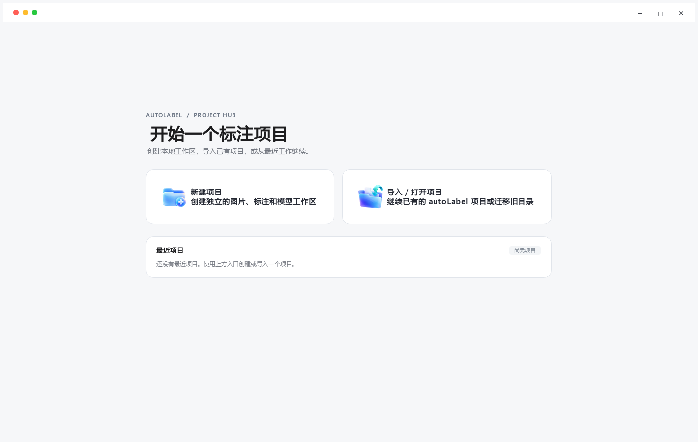
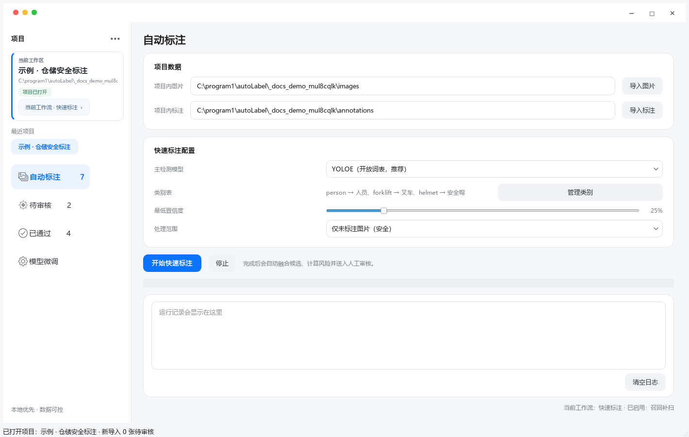
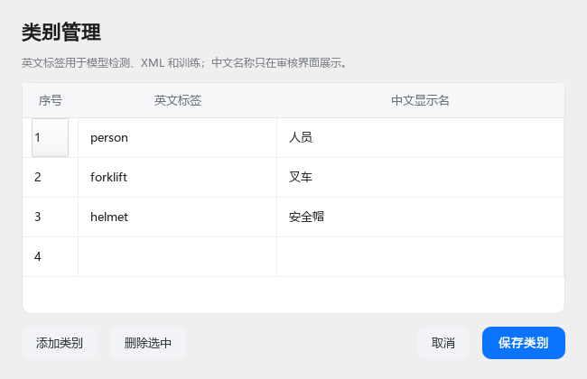
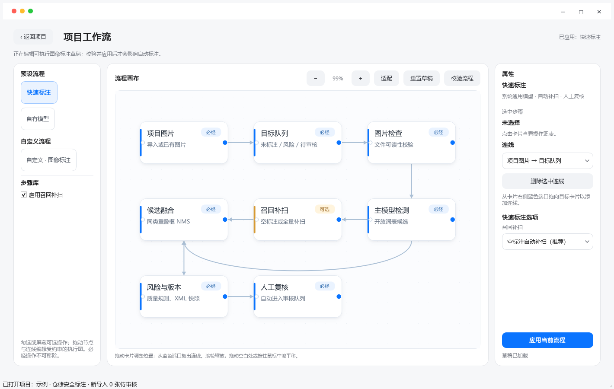
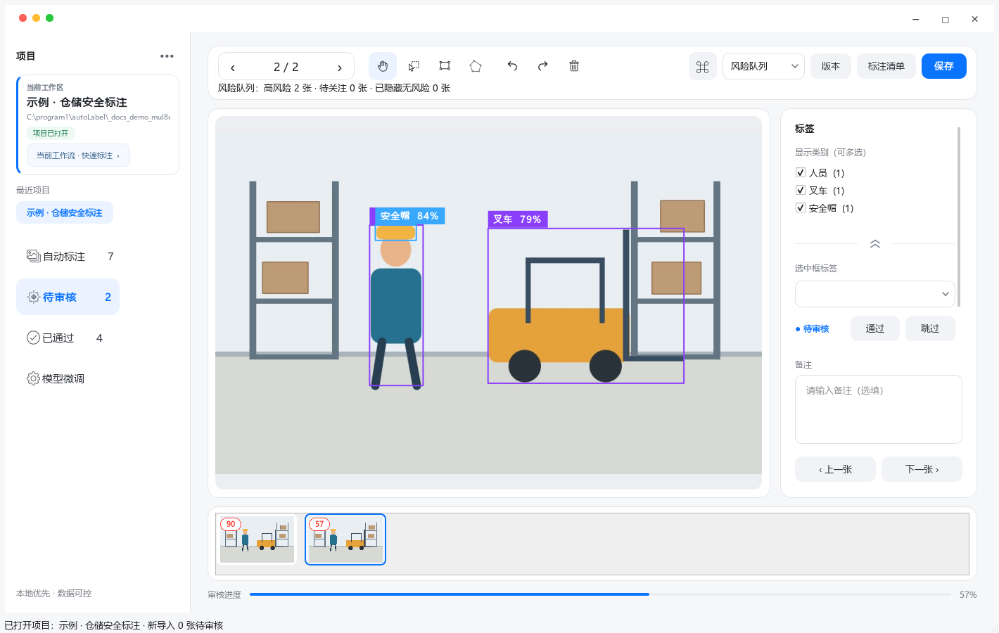
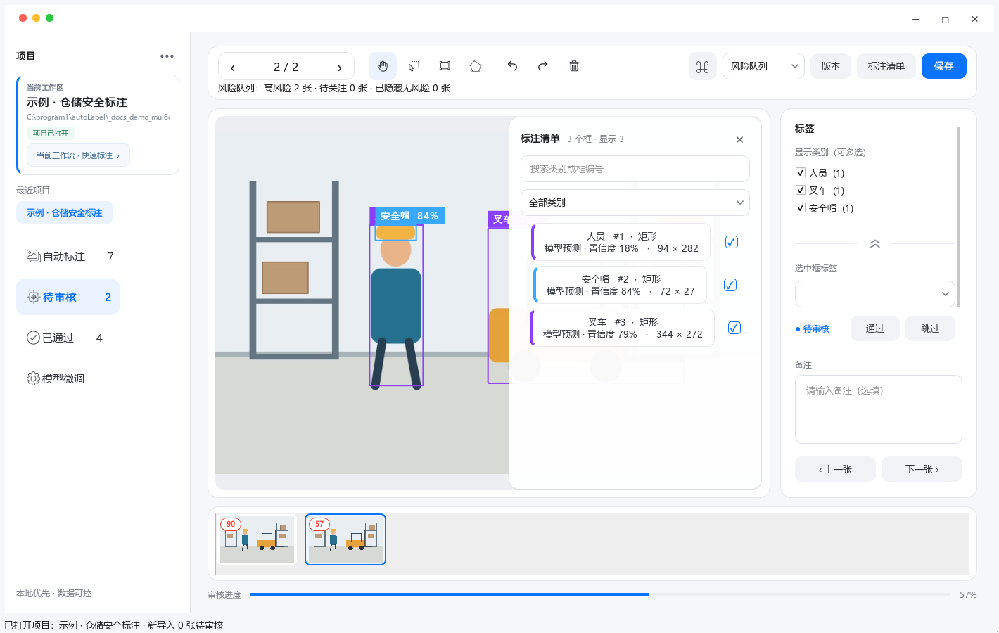
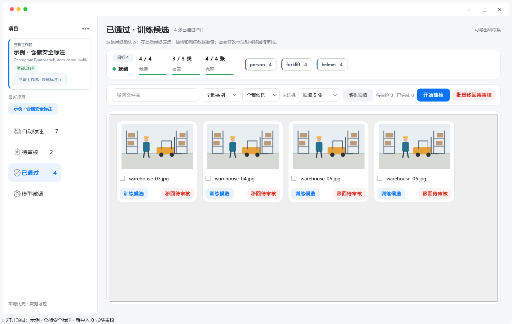
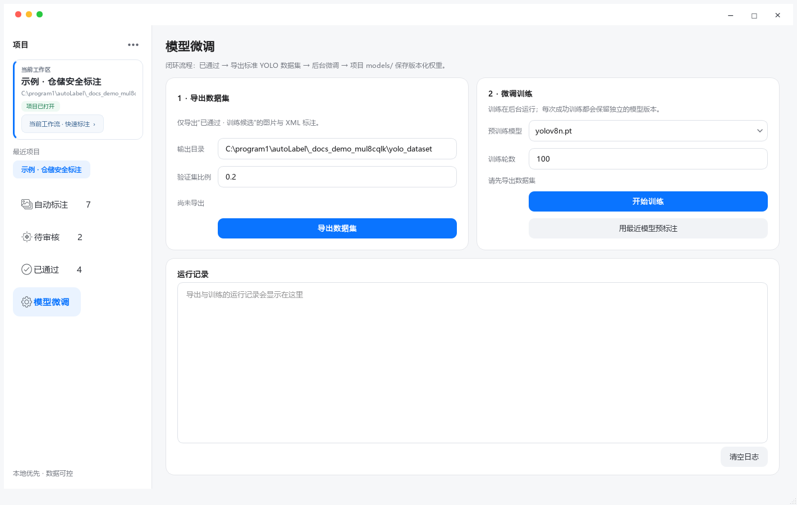

# autoLabel

autoLabel 是本地桌面图片标注工作台：在同一个项目中完成图片导入、模型预标注、人工审核、训练集导出与可选的 YOLO 微调。图片和标注留在本机，项目状态由 SQLite 管理，不需要 MySQL 服务。

> 以下截图来自脚本生成的临时示例项目，图片内容和标注均为演示数据，不包含真实用户项目。界面以当前 PySide6 版本为准。

## 目录

- [安装与启动](#安装与启动)
- [从建项目到训练集](#从建项目到训练集)
- [各页面操作](#各页面操作)
- [审核快捷键](#审核快捷键)
- [技术实现与数据存储](#技术实现与数据存储)
- [常见问题](#常见问题)
- [开发与验证](#开发与验证)

第一次接手代码可先读[开发者上手指南](docs/developer-guide.md)：入口、模块职责、图片生命周期和修改位置都在其中。

## 安装与启动

需要 Python 3.10+。在仓库目录执行：

```bash
pip install -r requirements.txt
python main.py
```

模型文件存放在仓库的 `weights/`，大文件由 Git LFS 管理。克隆仓库前请安装 Git LFS；已有克隆在仓库目录执行 `git lfs install` 和 `git lfs pull`，确保下载到真实模型文件，而不是 LFS 指针。模型文件合计约 2.6 GiB，首次下载需要相应的磁盘空间和网络流量。

界面使用 PySide6，图像与 VOC XML 处理使用 OpenCV、Pillow 等库；模型相关依赖见 `requirements.txt`。安装清单中的 CLIP 依赖来自 GitHub，因此完整安装需要能访问相应来源。YOLOE 默认使用 `weights/yoloe-11l-seg.pt`；GPU 加速还需要与本机 CUDA 环境相匹配的 PyTorch。

首次启动后，在首页新建项目，或打开已有项目目录。后续启动会尝试恢复上一次有效项目；也可以从左侧“最近项目”切换。

## 从建项目到训练集

| 阶段 | 操作 | 结果 |
| --- | --- | --- |
| 1. 建项目 | 首页选择“新建项目”，输入名称和保存位置 | 创建独立的 `images/`、`annotations/`、数据库等目录 |
| 2. 准备数据 | 在“自动标注”页导入图片；已有 VOC XML 可另行导入 | 图片进入项目目录，原始文件仍可自行备份 |
| 3. 配置类别与模型 | 在“管理类别”设置英文标签和中文显示名，选择模型与置信度 | 英文标签写入 XML/训练集，中文仅用于界面显示 |
| 4. 预标注 | 选处理范围，点击“开始快速标注” | 生成 XML、风险分和版本记录，结果进入待审核 |
| 5. 人工审核 | 修改框后“通过”或“跳过” | 通过的图片进入训练候选；跳过暂缓处理 |
| 6. 导出 | 在“模型微调”页点击“导出数据集” | 生成项目内 `yolo_dataset/`，可以到此为止 |
| 7. 可选微调 | 选择预训练模型和轮数，点击“开始训练” | 模型结果保存在项目 `models/`，可用于再次预标注 |

如果只需要训练数据，完成第 6 步即可；“导出数据集”和“开始训练”是两个独立操作，不必为了取得数据而训练模型。

## 各页面操作

### 1. 项目首页



- “新建项目”会在所选位置创建一个独立项目文件夹；“导入 / 打开项目”用于继续已有项目。左侧项目区的 `•••` 也提供这些入口。
- 最近项目是快捷切换入口。移除最近项目记录**不会删除**项目文件；“删除当前项目及全部数据”是另一项需要输入项目名确认的操作。
- 如果上次项目目录被移动、删除或失去写入权限，应用会给出选择其他项目、只读查看或从最近项目移除等恢复选项，不会自动删除原数据。

### 2. 自动标注与类别管理



1. 用“导入图片”把图片放入当前项目的 `images/`；已有 VOC XML 可用“导入标注”导入。页面中的路径框用于确认项目内实际位置。
2. 点“管理类别”，为每类填写英文标签（如 `person`）和中文显示名（如“人员”）。英文标签用于模型提示、XML 与训练；中文名便于审核时阅读。
3. 选择主检测模型。可用 YOLOE、兼容的 Grounding DINO、已训练的 YOLO 或导入的项目模型；实际可用项取决于本地权重与依赖。
4. 调整“最低置信度”：低一些会保留更多候选框，高一些会过滤更多低分框。默认值为 25%，它是写入候选框的门槛，不是人工标注质量分。
5. 选处理范围，再点击“开始快速标注”。默认“仅未标注图片”最安全；“风险队列”“所有待审核图片”和“全部图片”用于重跑。全量重跑已通过图片后，它们会重新进入待审核。



预标注和重跑会留下可恢复的 XML 版本。若重跑前的当前 XML 与已有版本完全相同，就不再存一份重复的“重跑前结果”；若人工或外部工具改过且内容尚未留档，则先保存它。每次新的模型结果仍单独留档。

### 3. 项目工作流（进阶）



从左侧项目卡片进入“当前工作流”。“快速标注”是当前可执行的预设流程；可在画布中查看步骤、连线和可选的召回补扫，修改草稿后先“校验流程”，再“应用当前流程”。“自有模型”等流程目前可编辑草稿，不能据此假定已有可执行后端。普通批量标注可直接使用默认快速标注，无需进入此页。

### 4. 待审核



- 画布中可缩放、平移、选择并移动框，拖动八个控制点缩放矩形；也可新建矩形或多边形。单击已有框后才进入该框的编辑状态：鼠标指向选中框时显示选择光标，指向控制点时显示缩放光标。未选中框上按住左键拖动会平移图片，避免误移标注；滚轮缩放图片。矩形工具下拖动空白处画新框，按住 `Ctrl` 拖动可在已有框上画重叠框。双击空白处复位视图。修改会自动保存，点“保存”可手动确认。
- 右侧“显示类别”是**画布可见性筛选**，支持多选，类别名后面的数字是当前图片该类的框数；它不改变 XML。下方“选中框标签”才用于修改当前选中框的类别，框色会随类别同步变化。
- 右侧“通过”把图片加入训练候选；“跳过”表示暂缓，不计入完成进度，也不参与训练。已跳过图片可通过顶部筛选找到并移回待审核。
- 底部细进度条始终表示全项目“已通过 / 已进入审核”的比例，不随当前筛选队列变化。顶部页码只表示当前筛选结果中的位置。
- 顶部可选全部待审核、风险队列、低置信度、空标注和已跳过；切换筛选后从新结果的第一张开始。风险队列只保留命中质量规则的图片，并按风险分从高到低排序。
- “版本”可查看和恢复预标注 XML；备注按图片保存在项目数据库中。

当一张图的框很多时，点“标注清单”或按 `L` 打开画布右侧的覆盖式清单。这里可搜索、按类别筛选、单独隐藏/显示某个框，并点击条目定位，不会挤压右侧检查器。类别名和来源过长时会省略显示，悬浮条目可查看完整内容。



风险分来自空标注、低置信度、越界框、极小框、疑似重复框或异常标注等规则，表示**审核优先级**，不等于模型置信度，也不能代替人工确认。当前风险分和命中规则写入项目 SQLite；旧项目首次建立索引、或检测到图片/XML 变化时在后台更新。筛选时读取索引，不逐张同步重新解码图片；缩略图按当前位置分段加载。

### 5. 已通过 · 训练候选



这里是最终候选区，可按文件名、类别和抽检状态筛选，查看候选数量、类别覆盖及标注完整度。顶部“目标”是项目级提醒值，可调整，不是导出必须达到的硬门槛。

需要复核时选择“抽取 5/10/20 张”并点“随机抽取”，再点“开始抽检”进入审核画布。抽检通过仍保留训练候选；发现问题可移回待审核继续修改。“批量移回待审核”和图片卡片中的“移回待审核”只撤销通过状态，不删除原图或 XML。

### 6. 导出数据集与可选微调



左侧第 1 步只导出**已通过**的图片与标注。填写验证集比例（默认 `0.2`，须大于 0 且小于 0.9），点击“导出数据集”后，项目 `yolo_dataset/` 会生成 `data.yaml`、`images/train`、`images/val`、`labels/train` 和 `labels/val`。多边形会以外接矩形导出为 YOLO 检测框。若目标目录已有数据，应用会要求确认完整替换。

只想拿到训练集时，到这里即可复制 `yolo_dataset/`，**不需要点击“开始训练”**。注意 `data.yaml` 中的 `path` 是导出时的绝对路径：把数据集复制到其他机器或目录后，需要把它改成新位置。

右侧第 2 步为可选训练：导出成功后选择预训练模型与轮数，点击“开始训练”。状态区会显示数据扫描、数据加载器启动、训练批次、验证等阶段和已运行时间；运行记录会持续更新阶段与轮次，长阶段每约 30 秒提示仍在等待。训练在独立进程中运行；使用 GPU 时，Windows 下会根据训练集规模使用 2～4 个并行加载进程。点击“停止训练”会先请求正常退出；若当前步骤 5 秒内无法响应，会终止训练进程，取消的结果不会设为默认模型。成功权重复制到项目 `models/` 并保留版本；随后可在自动标注页用最近模型重新预标注。

## 审核快捷键

| 操作 | 快捷键 |
| --- | --- |
| 上一张 / 下一张 | `←` / `→`，长按可连续翻页 |
| 平移画布 | `H`；空白处或未选中框上拖动平移；单击框选中后可编辑；滚轮缩放，双击空白处复位 |
| 新建矩形 / 多边形 | `R` / `P`；矩形工具下空白处拖动画框，先单击已有框再拖动编辑；`Ctrl` + 拖动可画重叠框；多边形逐点点击，双击结束 |
| 撤销 / 重做 | `Ctrl+Z` / `Ctrl+Shift+Z` |
| 删除选中框 | `Delete` |
| 保存 XML | `Ctrl+S` |
| 打开 / 关闭标注清单 | `L` |
| 通过 / 跳过并进入下一张 | `A` / `S` |

工具栏 `⌘` 按钮也提供快捷键速查。选中框时，类别同色描边、浅透明填充和控制点用于提示当前可编辑对象；未选中框保持各自类别颜色。

## 技术实现与数据存储

| 位置 | 职责 |
| --- | --- |
| `main.py`、`gui/qt_workbench.py` | 启动并转发到当前 Qt 工作台；没有旧版 Tk 页面入口 |
| `gui/workbench.py`、`gui/pages/` | 无边框窗口、项目切换及各业务页面；审核清单、缩略图和翻页逻辑各有独立模块 |
| `gui/canvas.py` | 图片缩放、平移、框编辑、选择反馈与撤销/重做 |
| `gui/ui.py`、`gui/icons.py`、`gui/theme.py` | 通用 Qt 控件、图标与统一样式 |
| `application/` | 模型预标注、快速流程、审核路由和训练服务 |
| `core.py`、`engine/` | 检测后端与兼容入口；VOC XML、质量规则、YOLO 数据集转换与训练执行分模块实现 |
| `project.py`、`storage/` | 兼容入口；项目清单、项目级 SQLite、最近项目工作区记录分模块实现 |

每个项目都是可复制的独立目录：

```text
my-project/
├── autolabel.project.json  # 项目名称与目录约定
├── autolabel.db            # 类别、审核状态、备注、风险索引、版本及训练记录
├── images/                 # 项目图片
├── annotations/            # 当前 VOC XML
├── annotation_versions/    # 预标注与必要的重跑前 XML 快照
├── yolo_dataset/           # 导出的标准 YOLO 检测数据集
├── models/                 # 导入或训练得到的项目模型
└── training_runs/          # 运行微调后生成的训练过程文件
```

应用级的最近项目与最后打开项目保存在 `%LOCALAPPDATA%\autoLabel\workspace.db`；项目图片、XML 和审核数据则留在各自项目中。受限环境下，工作区数据库可能回退到当前工作目录。

审核状态分为“未审核”“待审核”“已通过”“已跳过”。只有“已通过”会进入训练候选和导出；“已跳过”保留原图与 XML，可稍后移回待审核。当前风险索引与可恢复历史版本分别保存：前者用于快速筛选，后者用于回看模型重跑前后结果。

## 常见问题

**为什么重跑后可能出现三个版本？** 第一次预标注结果、重跑前当前 XML、第二次预标注结果各是一份；中间那份不一定是人工修改版。现在仅当重跑前 XML 与已有快照内容不同才额外保存，因此没有修改时通常只新增第二次预标注结果。已有的历史重复版本不会自动删除。

**“跳过”算审核完成吗？** 不算。它不增加完成进度，也不会进入导出训练集；用于暂时无法确认、需要以后再看的图片。可在“已跳过”筛选中移回。

**只需要训练数据，不想微调模型？** 只使用“模型微调”页左侧的“导出数据集”，复制 `yolo_dataset/` 即可。移动后记得修正 `data.yaml` 的 `path`。

**启动时上次项目打不开怎么办？** 检查项目目录是否仍存在且可写。恢复界面可选择其他项目、只读查看或移除最近项目记录；移除记录不删除项目文件。

**风险队列第一次打开为什么需要等待？** 旧项目可能尚无当前 XML 的质量索引，应用会在后台按图片和 XML 建立；建好后筛选直接查询 SQLite。当前项目中的人工保存和新预标注会同步更新对应记录。

## 开发与验证

```powershell
python -m py_compile gui\qt_workbench.py project.py main.py
$env:QT_QPA_PLATFORM='offscreen'
python -m unittest discover -s tests -p 'test_*.py'
```

文档截图可以用 `python tools/capture_readme_screenshots.py` 重新生成。脚本创建临时合成图片和项目，截取页面后清理临时数据；不会读取用户最近项目，也不会执行模型推理。
