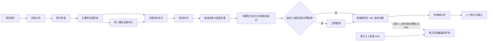

# 高召回预标注架构

## 目标与边界

目标是减少预标注后的目标漏检。系统保留低分、单模型独有和仅切片发现的候选，由审核员确认；候选框不能因另一模型未同意而被丢弃。误检数量和推理耗时是需要测量的代价。任何模型组合都不能保证零漏检。

当前可执行路径是 `QuickAnnotationWorkflow`。项目专用模型可作为主模型，开放词表模型作为第二路补扫；“自有模型”图预设仍是未接入的独立模式，不应把画布预设误认为可执行后端。

## 数据流



第二模型在“快速标注”预设中默认对每张图运行，可由项目流程关闭；大图切片步骤始终经过，但只在配置启用且图片长边达到阈值时推理。离线评测使用人工修改前的预标注快照，不能用通过后的标注计算模型召回率。

## 原子操作与契约

| 顺序 | 操作 | 输入 → 输出 | 失败处理 |
| --- | --- | --- | --- |
| 1 | `ValidateQuickTaskOperation` | 项目路径、模型配置 → 有效任务 | 拒绝启动；不改 XML |
| 2 | `SelectImageTargetsOperation` | 状态、处理范围 → 文件名序列 | 空队列直接结束 |
| 3 | `ImageReadinessOperation` | 图片路径 → 可读性确认 | 当前图片记录失败 |
| 4 | `CandidatePredictionOperation` | 主模型、整图、类别词、候选阈值 → 候选框 | 当前图片不写新 XML |
| 5 | `RecoveryPredictionOperation` | 第二模型、整图 → 独立候选框 | 当前图片不写新 XML；默认每张图执行 |
| 6 | `tile_windows` | 图片尺寸、960px 窗口、20% 重叠 → 覆盖边缘的切片坐标 | 参数无效则拒绝 |
| 7 | `TileCropOperation` | 原图、切片坐标 → 临时切片图片 | 单切片失败则当前图片不写新 XML |
| 8 | `CandidatePredictionOperation` | 已启用模型、切片图片 → 局部坐标候选 | 单模型失败则当前图片不写新 XML |
| 9 | `TileCoordinateRestoreOperation` | 局部候选、切片偏移 → 整图坐标候选 | 保留模型与切片来源 |
| 10 | `TiledPredictionOperation` | 切片计划、三项原子操作 → 已启用模型的切片候选 | 取消或失败时当前图片不写新 XML；临时切片清理 |
| 11 | `CandidateClassAlignmentOperation` | 模型类别、项目类别 → 标准类别或带未知类别标记的原词 | 不丢弃未识别类别 |
| 12 | `CandidateFusionOperation` | 所有模型和切片候选 → 候选并集 | 只合并同类且与组内每框 IoU ≥ 0.85 的近重复框 |
| 13 | `CandidateReviewTriageOperation` | 合并候选、参与模型 → 单模型/仅切片标记 | 分歧只影响审核优先级，不删除框 |
| 14 | `CandidateBoundsOperation` | 候选、图片尺寸 → 裁剪越界与无面积框 | 自定义流程可配置；无效框不导出 |
| 15 | `AnnotationPersistenceOperation` | 候选 → VOC XML、版本、质量索引 | 先快照旧版，完整写入新 XML 后替换；后续失败恢复旧版 |
| 16 | `ReviewRoutingOperation` | 成功写入的文件名 → 待审核状态 | 只路由成功文件；失败文件在日志汇总；全量重跑才重新打开已通过图片 |
| 17 | `evaluate_recall` | 独立人工真值 XML、预标注 XML → 逐类 TP/FP/FN、漏检清单 | 真值集为空拒绝评测；门槛不达标返回非零退出码 |

整图与切片的同一目标合并后，候选框保留 `model_sources`、`model_scores` 和 `review_flags` VOC 扩展字段。审核画布读写这些字段；人工修订或通过会清除待核验风险标记，并保留来源供追溯。原始模型分数不跨模型比较、排序或解释为统一概率；画布上的“原始最高分”仅供查看。

## 运行策略

- 新项目默认两模型全图运行，候选阈值 0.10。主模型为 YOLOE 时，第二路为 Grounding DINO；主模型选 Grounding DINO 时，第二路为 YOLOE。
- 长边达到 1600px 的图片默认执行 960px 窗口、20% 重叠的两模型切片补扫。该路径增加推理耗时，尤其适用于高分辨率小目标图；现场阈值应按真值集结果调整。
- 合并阈值 0.85 是保守初值。密集目标若仍被合并，应提高阈值；重复框过多再评估降低阈值。不能通过提高主模型分数门槛掩盖漏检。
- YOLO 推理端 NMS 的 IoU 阈值提高到 0.8，每张图片候选上限提高到 1000，减少密集同类目标被内部后处理提前截断的风险。这会增加重复框与推理后处理开销，需在真值集上回归。
- 多模型意见一致并不等于正确。审核员仍需查看没有候选框的画面区域；空图、单模型独有、仅切片发现和未知类别优先审核。
- 旧项目保留已保存的置信度与补扫策略；迁移到高召回设置时，应在工作流页选“每张图片双模型补扫”，并将候选阈值调至 10%。

## 验收与发布门槛

1. 从不同相机、产线、时段、光照、遮挡和目标尺寸抽取独立人工真值集。相邻帧或同批近重复图片不可跨训练集与真值集。评测前将**尚未人工修改的预标注 XML**复制到独立目录，防止人工修正结果抬高模型召回率。
2. 在部署使用的阈值下按类别统计 `Recall = TP/(TP+FN)`、`Precision = TP/(TP+FP)`、每千个目标漏检数和每张图候选数。另统计“有目标却零候选”的图片比例、人工补框数、审核耗时和单张推理耗时。
3. 对关键类别设项目级最低召回率门槛；`tools/evaluate_preannotations.py --min-recall class=0.99` 可作为示例门槛，具体值由现场风险决定。没有该类真值样本时视为未通过，而非 100% 召回。
4. 每次变更模型、提示词、阈值、切片或去重规则，都使用同一封存真值集回归。先看漏检清单，再看总体平均指标；不能用训练集分数替代现场验收。
5. 上线初期保持人工逐图审核。只有持续监测证明某些场景满足门槛，才考虑缩减其审核量；关键类别的新场景仍进入人工检查。

示例命令：

```powershell
python tools/evaluate_preannotations.py --ground-truth C:\gold\annotations --predictions C:\project\annotations --iou 0.5 --min-recall helmet=0.99 --output C:\reports\recall.json
```

## 后续扩展点

- 用项目审核数据训练闭集专用模型作为主模型，与开放词表模型形成互补；应通过独立真值集决定是否替换，而不是仅看训练 mAP。
- 按模型、类别与场景校准阈值后增加可配置的逐类门槛；当前 0.10 是高召回初值，不是工业达标证明。
- 接入误检验证器或更复杂的框融合时，必须维持“单模型独有候选可审核”的约束，并与现有方案做漏检和审核耗时的对照实验。
