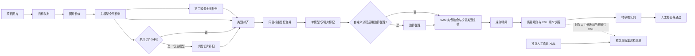

# 高召回预标注架构

## 目标与边界

目标是减少项目已配置类别的预标注漏检。系统保留低分、单模型独有和仅切片发现的已配置类别候选，由审核员确认；候选框不能因另一模型未同意而被丢弃。类别表外的模型输出不进入项目 XML，以免通用模型的其他类别占满审核画布。模型将真实目标误识别为表外类别时仍可能漏检，须通过人工复核与独立真值集评测。误检数量和推理耗时是需要测量的代价；任何模型组合都不能保证零漏检。

当前可执行路径是 `QuickAnnotationWorkflow`。项目专用模型可作为主模型，开放词表模型作为第二路补扫；“自有模型”图预设仍是未接入的独立模式，不应把画布预设误认为可执行后端。

## 数据流



第二模型在“快速标注”预设中默认对每张图运行，可由项目流程关闭。切片补扫在新项目默认关闭，可在工作流程画布中勾选并应用；开启后只由主模型处理长边达到阈值的图片，第二模型仍只运行整图。旧项目若已应用切片节点则继续启用。离线评测使用人工修改前的预标注快照，不能用通过后的标注计算模型召回率。

## 原子操作与契约

| 顺序 | 操作 | 输入 → 输出 | 失败处理 |
| --- | --- | --- | --- |
| 1 | `ValidateQuickTaskOperation` | 项目路径、模型配置 → 有效任务 | 拒绝启动；不改 XML |
| 2 | `SelectImageTargetsOperation` | 状态、处理范围 → 文件名序列 | 空队列直接结束 |
| 3 | `ImageReadinessOperation` | 图片路径 → 可读性确认 | 当前图片记录失败 |
| 4 | `CandidatePredictionOperation` | 主模型、整图、类别词、候选阈值 → 候选框 | 当前图片不写新 XML |
| 5 | `RecoveryPredictionOperation` | 第二模型、整图 → 独立候选框 | 当前图片不写新 XML；默认每张图执行 |
| 6 | `tile_windows` | 图片尺寸、960px 窗口、20% 重叠 → 覆盖边缘的切片坐标 | 参数无效则拒绝 |
| 7 | `TileCropOperation` | 原图、切片坐标 → 临时切片图片 | 单切片失败则当前图片不写新 XML |
| 8 | `CandidatePredictionOperation` | 主模型、切片图片 → 局部坐标候选 | 单模型失败则当前图片不写新 XML |
| 9 | `TileCoordinateRestoreOperation` | 局部候选、切片偏移 → 整图坐标候选 | 保留模型与切片来源 |
| 10 | `TiledPredictionOperation` | 可选切片计划、三项原子操作 → 主模型切片候选 | 未启用则跳过；取消或失败时当前图片不写新 XML；临时切片清理 |
| 11 | `CandidateClassAlignmentOperation` | 模型类别、项目类别 → 类别表内的标准类别 | 类别表外的模型候选排除，并在运行日志中计数 |
| 12 | `CandidateFusionOperation` | 所有模型和切片候选 → 去重后的候选并集 | 只合并同类、中心与面积接近，且与组内每框都达到对应 IoU 门槛的候选；独立框保留 |
| 13 | `CandidateReviewTriageOperation` | 合并候选、参与模型 → 单模型/仅切片标记 | 分歧只影响审核优先级，不删除框 |
| 14 | `CandidateBoundsOperation` | 候选、图片尺寸 → 裁剪越界与无面积框 | 自定义流程可配置；无效框不导出 |
| 15 | `SamMaskRefinementOperation` 与 `ClassVerificationOperation` | 相交/局部包含候选、SAM 2.1 Tiny、整图实例锚点、按需 YOLO11n → 实例融合候选和明确不同的框对 | 每图最多 32 个候选提示，额外最多 8 个辅助锚框或 4 个同类联合框；无权重、掩码无效或类别证据不足时保留原候选 |
| 16 | `CandidateRuleRefinementOperation` | 掩码核验后的候选、明确不同的框对 → 进一步合并后的候选 | 掩码明确不同的两个候选不得再次合并；其余按重叠和同源分数规则处理 |
| 17 | `AnnotationPersistenceOperation` | 候选 → VOC XML、版本、质量索引 | 先快照旧版，完整写入新 XML 后替换；后续失败恢复旧版 |
| 18 | `ReviewRoutingOperation` | 成功写入的文件名 → 待审核状态 | 只路由成功文件；失败文件在日志汇总；全量重跑才重新打开已通过图片 |
| 19 | `evaluate_recall` | 独立人工真值 XML、预标注 XML → 逐类 TP/FP/FN、漏检清单 | 真值集为空拒绝评测；门槛不达标返回非零退出码 |

整图与切片的同一目标合并后，候选框保留 `model_sources`、`model_scores` 和 `review_flags` VOC 扩展字段。跨类别融合另外保存 `alternate_labels`，并以 `class_conflict` 标记进入审核。审核画布读写这些字段；人工修订或通过会清除待核验风险标记，并保留来源供追溯。原始模型分数不跨模型比较、排序或解释为统一概率。画布每个框始终显示类别：未改动的模型候选附上原始分数，人工新增、修订和核验过的框显示对应状态；没有分数和状态的旧框显示“历史标注”。选中框详情与标注清单使用易懂的模型名称显示来源，XML 中仍保留原始来源编号。

## 运行策略

- 新项目默认两模型全图运行，候选阈值 0.10。主模型为 YOLOE 时，第二路为 Grounding DINO；主模型选 Grounding DINO 时，第二路为 YOLOE。开放词表模型只收到类别表中的提示词；固定类别 YOLO 在调用 `predict` 前将这些英文标签映射为权重类别 ID，传入 `classes` 限制返回结果。类别对齐保留为防御性检查。
- 第二模型即使在工作流中启用，若其默认权重在模型管理中已停用或尚未安装，本次运行会跳过第二模型并给出日志，不再加载已停用的模型。
- 新项目默认关闭切片补扫。项目需要找高分辨率小目标时，可在工作流画布启用“**大图切片补扫**”并应用；长边达到 1600px 后执行 960px 窗口、20% 重叠的主模型切片。关闭可减少切片推理和切片误报，但也可能漏掉只在切片中出现的小目标；应按项目真值集选择。
- 重复框合并同时检查类别、中心偏移、面积比例和 IoU：同一整图模型来源要求 IoU ≥ 0.90，同一切片来源 ≥ 0.70，不同来源 ≥ 0.75；中心偏移不得超过较大框边长的 16%，面积比例不得超过 1.60。每个新框必须与合并组内所有框相容，避免串联合并邻近目标。孤立候选原样保留，日志记录合并数量。密集同类场景仍须用独立真值集检查漏检；不能通过提高主模型分数门槛掩盖漏检。
- SAM 2.1 Tiny 可从模型管理按需下载。它只接收框 IoU ≥ 0.25 或较小框至少 55% 被覆盖的候选；每图最多 32 个候选提示，必要时增加最多 8 个辅助类别锚框及 4 个同类联合框，一张图只编码一次，按每批最多 8 框解码掩码。同类候选用掩码 IoU、包含关系和联合框掩码合并，输出保留候选坐标并集。不同类候选可由 YOLO11n 的实例掩码和类别判断合并；当辅助检测缺席、但已有可信的整图目标时，还可按整图掩码覆盖率吸收纯切片局部框。后一种方式保留整图框与类别。两种跨类别方式都记录原候选类别并进入高优先级审核；掩码不一致或多实例归属不明确时保持独立。完整门槛与退让规则见[实例融合与类别裁决设计](instance-reconciliation-algorithm.md)。
- SAM 批次缺少掩码时在同一图片编码下拆分重试，保留其他有效掩码。对极少数掩码质量差的低分同类切片碎片，若其被唯一高分整图框明显包含，且符合切片边界、面积比及来源约束，则吸收到整图框并加 `weak_mask_merge` 待核验标记；独立小目标保留。具体门槛见[实例融合与类别裁决设计](instance-reconciliation-algorithm.md)。
- 对 SAM 将同一实例分成不同掩码的高分切片框，还核验真实切片窗口边界、完整框的跨边界延伸、同类来源、面积比、包含率及唯一整图归属。对 SAM 单框失败的低分窄条使用更严格的几何条件；吸收结果以 `tile_fragment_merge` 提醒人工核验。拥挤图中被多个整图框覆盖的局部候选继续保留。
- 整图推理、切片、SAM、坐标裁剪与审核画布统一使用 EXIF 定向后的坐标。旧版本处理过的旋转图片需要重新运行预标注以修正已有 XML 坐标。
- 最后的规则精简只处理剩余的同类重叠框。IoU ≥ 0.82、中心偏移 ≤ 16%、面积比 ≤ 1.50 时直接合并；IoU ≥ 0.68、中心偏移 ≤ 12%、面积比 ≤ 1.40 时，只有共享模型来源的较弱分数 ≤ 较强分数的 85% 才合并。还有一项切片截断规则：较小框仅来自切片、边界落在切片网格附近、至少 85% 落在更大的整图框内、面积比 ≤ 2.50、中心偏移 ≤ 28%，并且其同模型分数 ≤ 完整框的 70%，才把它并入完整框并保留完整坐标。每个候选必须与组内所有成员相容；同时匹配两个组的拥挤候选保持独立。普通合并坐标在共享模型内按分数加权，不同模型分数不互相比较。规则不设全局低分删除门槛；仍须用人工真值集核对被合并的密集同类目标。
- 速度优化：默认不生成切片；开启后仅主模型跑切片，第二模型保留整图补扫。4288×2848 图片按当前窗口生成 24 张切片，双模型切片原需 48 次额外检测，现启用时为 24 次、关闭时为 0 次。YOLOE 对相同项目类别只执行一次 `set_classes`；临时切片使用无损 PNG 零压缩写入。上述是调用次数变化，实际耗时须在同一设备上测量。运行日志只汇总候选变化和 SAM 实际执行状态，不逐图输出耗时。
- 审核画布始终给每个可见框显示类别标题；模型候选可附上原始分数，便于在密集同类场景逐框辨认。
- YOLO 推理端 NMS 的 IoU 阈值提高到 0.8，每张图片候选上限提高到 1000，减少密集同类目标被内部后处理提前截断的风险。这会增加重复框与推理后处理开销，需在真值集上回归。
- 多模型意见一致并不等于正确。审核员仍需查看没有候选框的画面区域；空图、单模型独有和仅切片发现的候选优先审核。类别表外候选被排除后，须特别关注模型误分类造成的漏框。
- 旧项目保留已保存的置信度与补扫策略；迁移到高召回设置时，应在工作流页选“每张图片双模型补扫”，并将候选阈值调至 10%。

## 验收与发布门槛

1. 从不同相机、产线、时段、光照、遮挡和目标尺寸抽取独立人工真值集。相邻帧或同批近重复图片不可跨训练集与真值集。评测前将**尚未人工修改的预标注 XML**复制到独立目录，防止人工修正结果抬高模型召回率。
2. 在部署使用的阈值下按类别统计 `Recall = TP/(TP+FN)`、`Precision = TP/(TP+FP)`、每千个目标漏检数和每张图候选数。另统计“有目标却零候选”的图片比例、人工补框数、审核耗时和单张推理耗时。
3. 对关键类别设项目级最低召回率门槛；`tools/evaluate_preannotations.py --min-recall class=0.99` 可作为示例门槛，具体值由现场风险决定。没有该类真值样本时视为未通过，而非 100% 召回。
4. 每次变更模型、提示词、阈值、切片或去重规则，都使用同一封存真值集回归。先看漏检清单，再看总体平均指标；不能用训练集分数替代现场验收。
5. 上线初期保持人工逐图审核。只有持续监测证明某些场景满足门槛，才考虑缩减其审核量；关键类别的新场景仍进入人工检查。

示例命令：

```powershell
python tools/evaluate_preannotations.py --ground-truth C:\gold\annotations --predictions C:\project\annotations --iou 0.5 --min-recall helmet=0.99 --output C:\reports\recall.json
```

## 后续扩展点

- 用项目审核数据训练闭集专用模型作为主模型，与开放词表模型形成互补；应通过独立真值集决定是否替换，而不是仅看训练 mAP。
- 按模型、类别与场景校准阈值后增加可配置的逐类门槛；当前 0.10 是高召回初值，不是工业达标证明。
- 接入误检验证器或更复杂的框融合时，必须维持“单模型独有候选可审核”的约束，并与现有方案做漏检和审核耗时的对照实验。
